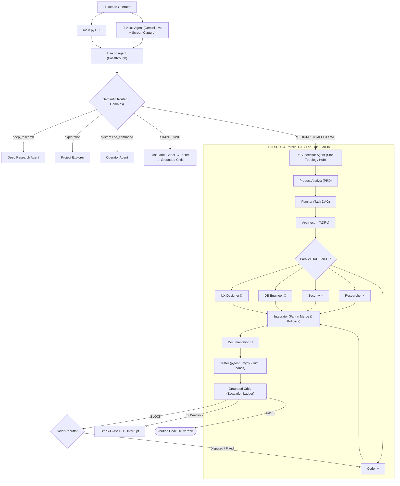
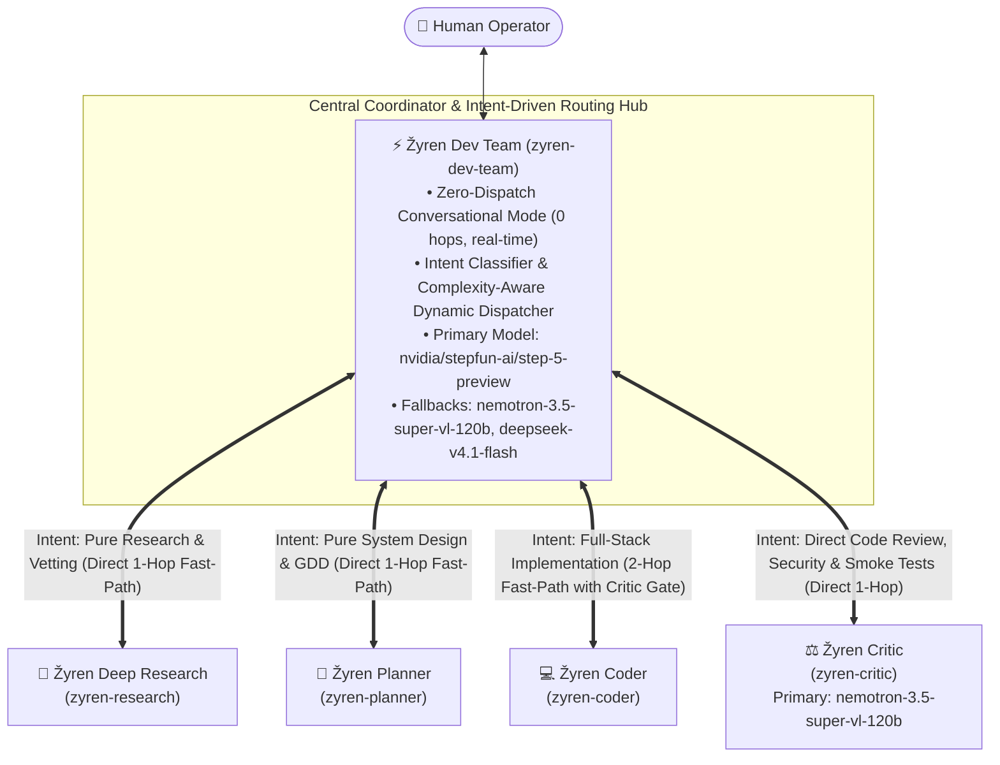

<p align="center">
  
</p>

# Engineering Autonomous Multi-Agent Software Swarms: Lessons from Three Architectural Generations

**An Empirical Case Study on Swarm Topology, Coordination Overhead, Horizontal vs. Vertical Decomposition, and Deterministic Runtime Verification**

* **Author / Brand:** Žyren (MONaser04)
* **Brand Clarification:** *Žyren* is the author's universal engineering, software development, and gaming brand across all digital platforms. It is not the name of an individual software architecture or standalone project; rather, this paper documents an evolving multi-system engineering journey conducted under the Žyren brand across three successive generations, culminating in the **ŽyrenClaw** autonomous software engineering runtime.
* **Date:** October 2026
* **Verified Reference Repositories & Execution Environments:**
  1. **Generation 1 (17+3 Agent Star-Topology SDLC Engine):** [MONaser04/Zyren-AI-Dev-Team-I](https://github.com/MONaser04/Zyren-AI-Dev-Team-I)
  2. **Generation 2A (Domain-Agnostic NVIDIA NeMo Execution Chassis):** [MONaser04/Zyren-NeMo-Chassis](https://github.com/MONaser04/Zyren-NeMo-Chassis)
  3. **Generation 2B (Dual-Brain Multimodal Liaison & Switchyard Router):** [MONaser04/Zyren-AI-Dev-Team](https://github.com/MONaser04/Zyren-AI-Dev-Team)
  4. **Generation 3 (Autonomous Prototyping & Engineering Runtime):** **ŽyrenClaw** (Decoupled OpenClaw Architecture + **LangClaw** `v0.4.0` Sidecar Engine) — *Continuously updated with official upstream releases (including `v2026.10.x+`) without breaking custom UI, gateway, or multi-agent topologies; open-source scaffold: [MONaser04/ZyrenClaw](https://github.com/MONaser04/ZyrenClaw)*

---

## Abstract

A widespread assumption in agentic system design is that increasing the number of specialized agents linearly improves software engineering capability. Empirical evidence from building and operating three distinct generations of multi-agent systems under the **Žyren** engineering brand demonstrates the opposite: unconstrained agent proliferation introduces severe coordination overhead, context fragmentation across handoffs (>30% semantic degradation), and interface contract drift when features are split horizontally across role boundaries.

This case study documents the complete architectural evolution of autonomous software engineering swarms built under the **Žyren** brand—all engineered solo from the ground up:
1. **Generation 1 (`Zyren-AI-Dev-Team-I`):** A 19,597-line Python monorepo built from scratch featuring **17 specialized SDLC agent roles** (+ 3 operational agents), a **LangGraph Supervisor Star Topology**, a **6-Domain Semantic Router**, **SmartGateway** with **Bayesian Thompson Sampling** across **10 LLM provider adapters**, and **29 offline test suites**.
2. **Generation 2 (`Zyren-NeMo-Chassis` & `Zyren-AI-Dev-Team`):** A modular, hardware-constrained (<50MB RAM local state footprint) infrastructure chassis built natively for the **NVIDIA NeMo / NIM ecosystem** and **NVIDIA AI Workbench**, paired with a **Dual-Brain Liaison Agent** combining a **Google Gemini Live API Voice Facade** (`gemini-3.1-flash-live-preview`) with an **NVIDIA Nemotron Reasoning Core** (`nvidia/nemotron-3-ultra-550b-a55b`).
3. **Generation 3 (`ŽyrenClaw`):** A strategic return to **OpenClaw**, customized at the CLI and UI layers into **ŽyrenClaw** (preserving 100% upstream update compatibility), augmented with the **LangClaw** state/memory sidecar, and distilled into a **5-agent Hub-and-Spoke architecture** governed by **Vertical Feature Slicing (Walking Skeletons)** and a **Mandatory Deterministic Runtime Critic Gate**.

---

## ⚡ Executive Blueprint & Evolutionary Journey (At a Glance)

> **For Engineers, Architects, and Tech Leaders:** If you do not have time to read the full 50-page technical monograph, this executive summary and evolution matrix captures the entire journey, breakthroughs, and architectural lessons from our initial 20-agent monolith to the current state-of-the-art ŽyrenClaw swarm.

### The Complete Evolutionary Journey Matrix

| Phase / Era | Core Architecture & Scale | Key Innovation & Tech Stack | Crucial Lesson / Failure Mode Overcome | Production Artifacts & Status |
| :--- | :--- | :--- | :--- | :--- |
| 🏛️ **Gen 1: The Bespoke SDLC Monolith** | **20 Agent Roles** (17 SDLC + 3 Ops) in a LangGraph Star Topology | • Built from scratch in **19,597 LOC Python**<br>• Custom SmartGateway with Thompson Sampling<br>• 29 offline mock test suites | ❌ **Coordination Tax & Context Loss:** Passing context across 17 specialist boundaries caused >30% semantic drift and massive token burn. | 📦 **Status:** [Zyren-AI-Dev-Team-I](https://github.com/MONaser04/Zyren-AI-Dev-Team-I)<br>*(✅ Completed & Archived)* |
| 🧠 **Gen 2: NVIDIA NeMo & Dual-Brain** | **Consolidated 2-Tier Hierarchy** (<50MB RAM local footprint) | • Native **NVIDIA NIM & AI Workbench** integration<br>• Dual-Brain: Gemini Live Voice Facade + Nemotron 550B Ultra Reasoning | ⚠️ **Plumbing vs. Runtime:** Proved high-speed voice and dual-tier routing, but lacked a unified native agent CLI runtime. | 📦 **Status:** [Zyren-NeMo-Chassis](https://github.com/MONaser04/Zyren-NeMo-Chassis) & [Zyren-AI-Dev-Team](https://github.com/MONaser04/Zyren-AI-Dev-Team)<br>*(✅ Completed & Archived)* |
| ⚙️ **Gen 3: Forging ŽyrenClaw** | **Decoupled Upstream Wrapper (Zero-Fork Runtime)** + **LangClaw** State Sidecar | • Decoupled UI & CLI branding (`zyrenclaw.cmd`)<br>• **100% upstream update immunity**<br>• SQLite episodic vector memory | ❌ **Horizontal Layer Trap:** Splitting frontend, backend, and DB across separate agents caused DOM ID and API schema mismatches. | 🔄 **Status:** [MONaser04/ZyrenClaw](https://github.com/MONaser04/ZyrenClaw)<br>*(✅ Production Baseline)* |
| 🚀 **Gen 4: Lean 5-Agent Topology** | **Strict Hub-and-Spoke** (Coordinator, Researcher, Planner, Coder, Critic) | • **Vertical Feature Slicing (Walking Skeletons)**<br>• **Deterministic Runtime Smoke Gate (`exec`)**<br>• Conway-aligned Full-Stack Coder | ✅ **Eliminated Frankenstein Code:** 100% autonomous delivery on first pass across 3 canary benchmarks (`modern-fruit-catcher`, `cat-playground`, `neon-void`), verified closed-loop self-repair, and 15-min unguided sprint delivery (10,515 playtest score). | 🎯 **Status:** `benchmarks/` (`modern-fruit-catcher/`, `cat-playground/`, `neon-void/`)<br>*(✅ Production Verified)* |
| ⚡ **Active Milestone: Overnight 3D Marathon** | **Long-Horizon Multi-Hour Autonomous Build** (`grand-project`) | • **10-Hour Elevated Session** (`timeoutSeconds: 36000`)<br>• **State-Anchored Protocol** (`PROGRESS.md` on disk against Compaction Cliff)<br>• **5.52GB Free RAM** allocated<br>• Full-scale 3D WebGL ecosystem (10–12 stages, modular core, procedural audio/shaders) | 🔄 **In-Flight Active Verification:** Stress-testing multi-hour autonomous resilience, zero-instruction execution, and closed-loop circuit breakers under prolonged unattended operation. | 🏃‍♂️ **Status:** `D:\Games\Games_Projects\grand-project/`<br>*(⚡ In-Flight Overnight Marathon)* |
| 💎 **Track 1: Code Intelligence Engine** | **AST + Call-Graph + NVIDIA Nemotron RAG** | • `code-outline`: AST sight (**96.2% token savings**)<br>• `code-graph`: **Mandatory Blast Radius Gate** on Critic<br>• `code-search`: Two-stage NVIDIA Embed & Rerank | ✅ **Eliminated Context Exhaustion & Breaking Changes:** Tools built, unit-benchmarked, and globally deployed. | 🛠️ **Status:** `scaffolds/tools/` (`code-outline`, `code-graph`, `code-search`)<br>*(✅ Built & Verified)* |
| 🧠 **Universal Distributed Memory & Self-Learning** | **Decentralized Capture (`DecentMem`/`DeLM`) + 768D Vector Index (`sqlite-vec` via MRL)** | • Native **NVIDIA Nemotron-3.5-Embed-8B** (MRL 768 dims) via cross-platform `sqlite-vec` (Linux `.so`, macOS `.dylib`, Windows `.dll`)<br>• Hybrid search (0.7 vector + 0.3 BM25) + MMR (λ=0.7)<br>• Role-specific autonomous memory logging (`critic-rules.md`, `dev-gotchas.md`, `research-patterns.md`, `architecture-contracts.md`) | ✅ **Closed-Loop Autonomous Self-Learning:** Verified zero-trust defect interception and permanent heuristic distillation into durable gotchas. | 🎯 **Status:** `benchmarks/cat-playground/`<br>*(✅ 100% Production Verified & Empirically Validated)* |
| 🔭 **Microsoft UFO OS Automation** *(Standby)* | **Native Windows GUI & Desktop Control** | • Microsoft UFO bridge (`live_ufo_bridge.py`)<br>• UI Automation (UIA) tree control & Vision-Language | ⏳ **Strategic Standby:** Architecture complete; tactically frozen awaiting desktop vision spatial grounding maturity. | ⏸️ **Status:** `projects/ufo-automation/`<br>*(⏸️ Architected & Placed on Standby)* |

---

### The Three Architectural Pillars of the Žyren Swarm

```
┌────────────────────────────────────────────────────────────────────────┐
│                        Žyren Dev Team (Coordinator Hub)                │
└───────┬───────────────────┬───────────────────┬──────────────────┬─────┘
        │                   │                   │                  │
        ▼                   ▼                   ▼                  ▼
┌──────────────┐    ┌──────────────┐    ┌──────────────┐   ┌───────────────┐
│ zyren-research│   │ zyren-planner│    │ zyren-coder  │   │ zyren-critic  │
│ Deep Research │   │ Architecture │    │ Full-Stack   │   │ Zero-Trust    │
│ & Benchmarks │    │ & Blueprints │    │ Vertical Dev │   │ Runtime Gate  │
└──────────────┘    └──────────────┘    └──────┬───────┘   └───────▲───────┘
                                               │                   │
                                               │  Code Deliverable │
                                               └───────────────────┘
                                                  (Mandatory Audit:
                                                   exec + code-graph)
```

1. **Pillar 1: Vertical Slicing Over Horizontal Fragmentation (Conway's Law Alignment)**  
   Never divide code generation across horizontal technical roles (`zyren-ui`, `zyren-db`, `zyren-backend`). A unified **Full-Stack Coder (`zyren-coder`)** builds cohesive, runnable **Walking Skeletons (80–85% complete on first pass)**, eliminating broken DOM bindings and mismatched API contracts.

2. **Pillar 2: Two-Layer Defense-in-Depth & Deterministic Runtime Gate (`zyren-critic`)**  
   Never trust natural-language reading alone to approve code. ŽyrenClaw enforces a rigorous **Two-Layer Defense-in-Depth verification architecture**: (1) **Layer 1 (Fast Heuristic Static Filter):** runs sub-40ms static blast radius analysis (`code-graph --impact`) to catch orphaned callers and interface shifts early; and (2) **Layer 2 (Mandatory Deterministic Runtime Gate):** executes real runtime smoke and syntax tests via `exec` (`node --check`, headless test runners, exit code 0) before approving code.

3. **Pillar 3: High-Performance Code Intelligence (AST Outline & NVIDIA Semantic Rerank)**  
   To eliminate context window overflow in enterprise repositories:
   • `code-outline` extracts classes, methods, and line ranges in <40ms, saving **96.2% of tokens**.  
   • `code-graph` tracks cross-file callers and dependencies statically without heavy LSP daemons.  
   • `code-search` combines **NVIDIA Nemotron-3.5-Embed-8B** and **Nemotron-3.5-Rerank-8B** with SQLite SHA-256 caching for sub-second natural language queries in English and Arabic.

---

### Quick Navigation Index
- [1. Generation 1: The 20-Agent Monolith (19,597 LOC)](#1-generation-1-building-a-20-agent-sdlc-engine-from-first-principles)
- [2. Generation 2: NVIDIA NeMo Chassis & Dual-Brain Liaison](#2-generation-2-the-nvidia-nemo-ecosystem--the-first-consolidation)
- [3. Generation 3: Evaluating NemoClaw & Forging ŽyrenClaw](#3-generation-3-evaluating-nemoclaw--forging-žyrenclaw)
- [4. Evolutions Inside ŽyrenClaw: The 5-Agent Hub-and-Spoke Topology](#4-evolutions-inside-žyrenclaw-from-7-node-intermediate-setup-to-the-5-agent-hub-and-spoke-topology)
  - [4.3 Engineering Anti-Fragility: Circuit Breakers, Polyglot AST, & Model Tiering](#43-engineering-anti-fragility-circuit-breakers-polyglot-ast--cognitive-model-tiering)
- [5. Breakthroughs: LangClaw & Vertical Feature Slicing](#5-the-two-game-changing-breakthroughs-langclaw--vertical-slicing)
- [6. Empirical Canary Benchmark & Playtest Audit Results](#6-empirical-validation--cross-generational-benchmarking)
- [7. Current Progress & Future Architectural Roadmap (Track 1 & Beyond)](#7-current-progress--future-architectural-roadmap)
- [8. Academic Citation & Reference](#8-citation--attribution)

---

## 1. Generation 1: Building a 20-Agent SDLC Engine from First Principles

### 1.1 Initial OpenClaw Friction & The First-Principles Imperative
The journey began with early builds of OpenClaw. At the time, manual installation presented significant friction, and early versions lacked granular controls for custom model injection, multi-provider fallback chains, and explicit reasoning/thinking depth configuration. Rather than accepting those limitations, OpenClaw was temporarily shelved in favor of engineering a complete multi-agent software development lifecycle (SDLC) engine from scratch to master every layer of multi-agent infrastructure: state sourcing, routing, sandboxing, memory, and verification.

### 1.2 Verified Repository Metrics & Stack (`Zyren-AI-Dev-Team-I`)
* **Repository:** [MONaser04/Zyren-AI-Dev-Team-I](https://github.com/MONaser04/Zyren-AI-Dev-Team-I)
* **Development Stack:** Engineered iteratively using **Antigravity** (Google Gemini and Anthropic Claude models) and **Cline** in VS Code (NVIDIA NIM Endpoints), backed by **Python 3.11+ (`uv`)**, **LangGraph**, and **Docker Compose** (`Postgres`, `Qdrant`, `LiteLLM`, `Jaeger`, `Langfuse`).
* **Codebase Scale:** **19,597 lines of Python source code** across **100 Python files** in 10 core packages (`orchestrator`, `agents`, `gateway`, `contracts`, `state`, `resilience`, `memory`, `tools`, `verification`, `observability`), validated by **29 offline test suites** (running with zero live API calls via `MockGateway`, `MockProviderAPIs`, and `MockEventStore`).

### 1.3 Complete Verified Agent Roster (17 Specialized SDLC Roles + 3 Operational Roles)
Inspection of `src/agents/` (23 Python modules) establishes the exact agent roster implemented in Generation 1:

#### A. The 17 Specialized SDLC Roles
| # | Agent Role | Source Module | Primary Responsibility & Contract | Architectural Notes |
|:---:|---|---|---|---|
| 1 | **Supervisor** | `src/agents/supervisor.py` | Central LLM-driven dynamic routing hub | ⭐ Central node in LangGraph Star Topology |
| 2 | **Product Analyst** | `src/agents/product_analyst.py` | Translates user prompt into `ProductRequirementDoc` (PRD), user stories, acceptance criteria | First stage of Full SDLC lane |
| 3 | **Planner** | `src/agents/planner.py` | Converts PRD into `TaskDAG`, dependencies, and agent assignments | Generates DAG structure |
| 4 | **Architect** | `src/agents/architect.py` | Produces `ArchitectDesign`, system components, and ADRs | ⭐ Equipped with Dedicated Critic |
| 5 | **UX/UI Designer** | `src/agents/ux.py` | Generates `UXDesign`, design tokens, and accessibility rules | 🔀 Conditional (frontend/full-stack only) |
| 6 | **DB Engineer** | `src/agents/db_engineer.py` | Produces `DataSchema`, table designs, and migrations | 🔀 Conditional (persistence tasks only) |
| 7 | **Coder** | `src/agents/coder.py` | Core code producer (`CodePatch`) + right of rebuttal (`RebuttalRequest`) | ⭐ Equipped with Dedicated Critic |
| 8 | **Tester** | `src/agents/tester.py` | Executes `pytest`, `mypy`, `ruff`, `bandit` via `src/verification/` | Emits facts-only `VerificationReport` |
| 9 | **Grounded Critic** | `src/agents/critic.py` | Evaluates `VerificationReport` + rubric to issue `ReviewDecision` (`PASS`/`BLOCK`) | Cross-model family + 3-step Escalation Ladder |
| 10 | **Integrator** | `src/agents/integrator.py` | Parallel DAG Fan-in merge reconciliation + automatic checkpoint rollback on failure | Convergence point after parallel Fan-out |
| 11 | **Security** | `src/agents/security.py` | OWASP Agentic Top 10 review + SAST analysis (`SecurityReport`) | ⭐ Equipped with Dedicated Critic |
| 12 | **Documentation** | `src/agents/docs.py` | Milestone-based docs: post-architecture ADRs (`docs_adr`) + post-integration final docs | 📍 Triggered only at milestones |
| 13 | **Liaison** | `src/agents/liaison.py` | Natural-language human interface passthrough & system action parser | 👤 Sole human operator entry point |
| 14 | **Researcher** | `src/agents/researcher.py` | On-demand resolution of technical knowledge gaps during SDLC execution | ⚡ Triggered dynamically on demand |
| 15 | **Professional Researcher** | `src/agents/professional_researcher.py` | Zero-LLM-knowledge verifier using **11 official provider doc fetchers** (`src/agents/researcher_docs/`) | 🔬 Cross-validates model specs & citations |
| 16 | **Deep Research** | `src/agents/deep_research.py` | Open-web multi-hop investigation and data aggregation (`ResearchReport`) | 🌐 Uses MCP web/search tools |
| 17 | **Project Explorer** | `src/agents/explorer.py` | Read-only codebase graph and repository structure analysis (`file_list`, `file_read`) | 🔍 Used for `EXPLORATION` routing |

#### B. Additional Operational & Self-Improvement Agents
| # | Agent Role | Source Module | Primary Responsibility |
|:---:|---|---|---|
| 18 | **Operator** | `src/agents/operator.py` | System administration (`system_command` / `os_command`): add, disable, or enable models and set routing defaults |
| 19 | **Voice Agent** | `src/agents/voice_agent.py` | Real-time voice interaction via **Google Gemini Live API** paired with live screen capture (`src/tools/screen_capture.py`) |
| 20 | **Optimizator** | `src/agents/optimizator.py` | Closed-loop self-improvement orchestrator (`optim/`): evaluates runs, analyzes failure patterns, and tunes prompts via **DSPy MIPROv2 / GEPA** |

*(Supporting factory module: `src/agents/critic_factory.py` dynamically instantiates role-specific critics for the three high-risk roles: Coder, Architect, and Security).*

### 1.4 Orchestration & Gateway Architecture in Generation 1
Unlike naive linear chains, `Zyren-AI-Dev-Team-I` implemented two distinct routing layers:

1. **Orchestration Layer (`src/orchestrator/graph.py` — 1,148 lines & `semantic_router.py`):**
   - **6-Domain Semantic Router:** Classifies incoming requests across `software_engineering`, `deep_research`, `media_production`, `conversational`, `system_command`, and `os_command`.
   - **Complexity Sub-Routing & Dual-Track Execution:** Within `software_engineering`, tasks are sub-classified into:
     - **Fast Lane (`SIMPLE` + high confidence):** Routes directly through `Coder` → `Tester` → `Grounded Critic`.
     - **Full SDLC Lane (`MEDIUM` / `COMPLEX`):** Routes through the **Supervisor Star Topology** (`Product Analyst` → `Planner` → `Architect` → **Parallel DAG Fan-out** across `UX`, `DB Engineer`, `Security`, `Researcher`, and `Coder` → **Fan-in** at `Integrator` → `Docs` → `Tester` → `Grounded Critic`).
   - **Grounded Feedback Loop & Right of Rebuttal:** Grounded in MIT Press/TACL research demonstrating that LLMs cannot reliably self-correct without external signals, the `Tester` executes real tools (`pytest`, `mypy`, `ruff`, `bandit`) first. If the `Grounded Critic` issues a `BLOCK` (using a 3-tier escalation ladder: *Soft* → *Firm* → *Hard*), the `Coder` can exercise a **Right of Rebuttal** (`RebuttalRequest`) once per iteration if the critique is a false positive. Unresolved deadlocks after 3 iterations trigger the **Human-in-the-Loop Break-Glass Protocol** (`src/orchestrator/hitl.py`).

2. **SmartGateway & Bayesian Model Routing (`src/gateway/smart_gateway.py` — 735 lines):**
   - All LLM calls pass through `SmartGateway` and `AutoModelRegistry` (`model_registry.py`, 814 lines) supporting **10 Provider Adapters** (`OpenAI`, `Anthropic`, `Google Vertex`, `NVIDIA NIM`, `Azure OpenAI`, `AWS Bedrock`, `Ollama`, `Together AI`, `Fireworks AI`, `Groq`).
   - **6-Factor Routing & Thompson Sampling:** `SmartRouter` selects models based on Task Complexity, Required Capabilities, Cost Budget (`CostTracker`), Availability (`CircuitBreaker`, `FallbackChain`, `RateLimiter`, `HealthMonitor` in `src/resilience/`), Manual Overrides, and **Bayesian Model Quality Tracking** (`bayesian_tracker.py`), which maintains a `Beta(α, β)` distribution per model calibrated offline against an **80-question golden dataset** (`golden_dataset.json`).



### 1.5 Why Generation 1 Prompted Architectural Rethinking
Building `Zyren-AI-Dev-Team-I` from scratch provided exhaustive mastery over event-sourced state (`src/state/`), strict Pydantic v2 contracts (`src/contracts/schemas.py`, 797 lines), MCP tool governance (`src/tools/`), episodic Qdrant + semantic memory (`src/memory/`), and OpenTelemetry GenAI tracing (`src/observability/`). However, operating a 17-to-20 agent roster revealed fundamental scaling bottlenecks:
* **Coordination Overhead & Latency:** Routing across 17 specialized roles—even with a central Supervisor and Fast/Full lanes—consumed massive token budgets and multi-minute latencies in inter-agent serialization before producing working application files.
* **Context Degradation Across Handoffs:** Passing specifications from `Product Analyst` → `Planner` → `Architect` → `UX` / `DB` / `Coder` → `Integrator` introduced cumulative semantic loss.

---

## 2. Generation 2: The NVIDIA NeMo Ecosystem & The First Consolidation

### 2.1 Embracing NVIDIA NIM Blueprints & AI Workbench
Driven by a deep technical affinity for NVIDIA's AI ecosystem—and a commitment to iteratively rebuild from the ground up whenever a cleaner architecture emerges—the next phase focused on leveraging official NVIDIA libraries, NIM inference blueprints, **NVIDIA AI Workbench**, and **Docker Desktop** to construct a streamlined, enterprise-grade foundation optimized for **NVIDIA NIM Endpoints**.

This phase was split into two repositories: first building a reusable, domain-agnostic execution chassis (**`Zyren-NeMo-Chassis`**), and then building the multi-agent software team on top of it (**`Zyren-AI-Dev-Team`**).

### 2.2 Generation 2A: `Zyren-NeMo-Chassis` (The Domain-Agnostic Plumbing)
* **Repository:** [MONaser04/Zyren-NeMo-Chassis](https://github.com/MONaser04/Zyren-NeMo-Chassis)
* **Core Philosophy:** Pure infrastructure plumbing with zero hardcoded business logic, engineered to run within a **<50MB RAM local state footprint** on budget hardware (16GB RAM / GTX 1650 class) by offloading heavy inference to cloud NVIDIA NIM endpoints.
* **Verified Subsystems (`src/` & `config/`):**
  1. **Immutable Pydantic v2 Contracts (`src/contracts/`):** Content-addressed `ArtifactItem` (with automatic SHA-256 checksum deduplication), `NodePayload` envelopes with `correlation_id` tracking, `ExecutionSignal` (`CONTINUE`, `HALT`, `RETRY`, `BRANCH`), `ValidationDecision`, and discriminated unions (`polymorphic.py`: `NIMModelInput`, `RepoSourceInput`).
  2. **SQLite WAL Event-Store & Session Recovery (`src/state/`):** Asynchronous `aiosqlite` event store in Write-Ahead Logging (WAL) mode (`event_store.py`) implementing the `nemo-rl-session-memory` durable recovery pattern (capable of exporting full session bundles: `session_state.md`, `timeline.md`, `handoff.md`, `files.md`).
  3. **Dual-Mode NIM Client & Rate-Limiting (`src/infrastructure/`):** `NIMClient` (`nim_client.py`) with automatic truncated-response continuation (`auto_continue_truncated=True`) and dual rate-limiting (`rate_limiting.py`): `TokenBucket` for burst workloads and `StrictRateLimiter` (enforcing exact `60 / max_rpm` second spacing) to prevent HTTP 429 drops on cloud NIM tiers, alongside `GitOps` (`git_ops.py`) for parallel cloning of 180+ NVIDIA blueprint repositories (`config/repos.yaml`).
  4. **NeMo Guardrails & Nemotron Governance (`src/governance/`):** `GuardrailsEngine` wrapping `RunnableRails` and Colang flows (`config/rails/`), `PolicyGenerator` translating natural-language rules into 22 Nemotron V2 safety categories (`config/policies/v2_taxonomy.yaml`) across 8 deployment archetypes (`archetypes.yaml`), and a `DeprecationRegistry` (`nims.deprecated.yaml`) blocking 31 deprecated NIM identifiers at runtime.
  5. **LangGraph Engine, Test-Time Compute & Process-Group Sandbox (`src/runtime/` & `src/sandbox/`):** `WorkflowEngine` (`engine.py`) wrapping LangGraph `StateGraph` with `NeMoRelayIntegration` (`ContextVar` scope isolation across async threads), `TTCExecutor` (`ttc.py`) for Test-Time Compute (majority voting / best-of-N selection), and `SandboxRunner` (`runner.py`) using OS process groups (`os.killpg` + `SIGKILL`) for clean zombie reaping.
  6. **Tri-Protocol Observability (`src/observability/`):** Simultaneous export to **ATOF** (`events.jsonl`), **ATIF v1.7 trajectories** (`ATIFTrajectorySubscriber`), and **OpenTelemetry** (`OpenTelemetryExporter`).
  7. **NVIDIA AI Workbench Native Spec (`.project/spec.yaml`):** Built on `nvcr.io/nvidia/ai-workbench/python-basic:1.0.9` with automated `preBuild.bash`, `postBuild.bash`, and `onStart.bash` container lifecycle hooks.

### 2.3 Generation 2B: `Zyren-AI-Dev-Team` & The Dual-Brain Liaison Architecture
* **Repository:** [MONaser04/Zyren-AI-Dev-Team](https://github.com/MONaser04/Zyren-AI-Dev-Team)
* **Consolidation Target (17 Agents → 6 Agents):** Guided by 2026 industry research from NVIDIA and Google demonstrating that smaller, consolidated agent teams outperform sprawling swarms by eliminating handoff entropy, the new environment was planned around **6 core agents** instead of 17.
* **What Was Engineered in `Zyren-AI-Dev-Team` Before the OpenClaw Pivot:**
  Built directly atop the `Zyren-NeMo-Chassis`, development of `Zyren-AI-Dev-Team` began by engineering the centerpiece human-swarm coordinator: the **Dual-Model Liaison Agent (`src/agents/liaison/`)** and the **Switchyard Model Router (`src/routing/router.py`)**:
  1. **Brain 1 — The Real-Time Voice & Multimodal Facade (`src/agents/liaison/voice/facade.py`):**
     - Powered by **Google Gemini Live API** (`model: "gemini-3.1-flash-live-preview"`, voice `"Zephyr"`).
     - Full asynchronous audio/video streaming pipeline (`audio_pipeline.py` at 16kHz PCM input / 24kHz output, `video_pipeline.py` at 1 FPS JPEG screen/camera streaming, `transcription.py`, and `SessionResumptionManager` automatically seamlessly resuming sessions at the 840s/900s boundary).
  2. **Brain 2 — The Deep Reasoning Text Core (`src/agents/liaison/reasoning/core.py`):**
     - Powered by **NVIDIA NIM Endpoints** routed through **`SwitchyardRouter`** (`src/routing/router.py` & `config/models.yaml`):
       - `reasoning` target → `nvidia/nemotron-3-ultra-550b-a55b` (`rate_limit_mode: "strict"`, 40 RPM).
       - `coding` / `fast` / `default` targets → `nvidia/nemotron-3.5-lightning-30b-a3b` (`rate_limit_mode: "token_bucket"`, 40 RPM).
     - Includes multi-pattern regex **Thinking Extraction** (`_extract_thinking` in `core.py`), stripping `<thought>` / `<thinking>` blocks from user-facing replies while preserving internal reasoning traces in the `EventStore`, alongside cross-session conversation persistence via `.liaison_session`.
  3. **Strict Consensus Dispatch Gate (`src/agents/liaison/dispatch_gate.py`):**
     - Implements `PlannerDispatchGate` and `ConversationStateTracker`, preventing premature task execution by gating `request_planner_dispatch` until either an explicit user command (`"send to planner/system/company"`) or verified multi-turn specification consensus is confirmed.

---

## 3. Generation 3: Evaluating NemoClaw & Forging ŽyrenClaw

### 3.1 The NemoClaw Evaluation & Strategic Pivot Back to OpenClaw
While in the early stages of expanding `Zyren-AI-Dev-Team` toward its 6-agent target, parallel research was conducted into **OpenClaw's** evolving capabilities—specifically triggered by NVIDIA's research and release of **NemoClaw** (which wraps OpenClaw inside isolated **NVIDIA OpenShell** containers with security guardrails and policy enforcement).

* **Hardware Reality Check:** Evaluating NemoClaw revealed that running its full isolated container/micro-VM stack required local compute and memory resources beyond the workstation's 16GB RAM envelope.
* **The Pivot:** Rather than forcing an overweight container stack onto constrained hardware, the decision was made to return to native **OpenClaw** (continuously maintained in sync with official upstream releases) and bring **Antigravity** (using Google **Gemini 3.6 / 3.7 / 3.8 Flash** and Claude models) directly into the workflow to re-architect the local OpenClaw environment into a rock-solid autonomous system.

### 3.2 Rebranding & Decoupled Upstream Engineering: OpenClaw → ŽyrenClaw
**Žyren** is not the name of a single repository—it is the author's overarching identity and brand across all software architectures, developer tools, and gaming platforms. Accordingly, the local OpenClaw installation was transformed into **ŽyrenClaw**:

1. **Visual Identity & "Ž" Monogram:** The control dashboard UI (`~/.openclaw/ui/`) and agent avatars in `openclaw.json` were restyled with the custom **Žyren "Ž" logo** and dark `"knot"` theme.
2. **Native PowerShell Gateway Wrapper (`zyrenclaw gateway`):** Custom CLI entrypoints (`zyrenclaw.ps1` and `zyrenclaw.cmd` residing in the global environment bin path) were engineered so the entire platform launches natively from PowerShell via:
   ```powershell
   zyrenclaw gateway
   ```
   When `zyrenclaw gateway` is invoked, it executes `~/.openclaw/ensure-gateway.js`, which verifies HTTP health on `http://127.0.0.1:18789/`, runs `sqlite-self-heal.js` to clear any stale SQLite lock states, and starts the `"OpenClaw Gateway"` background daemon. For all other CLI flags, `zyrenclaw.ps1` forwards arguments transparently to `node_modules/openclaw/openclaw.mjs`.
3. **Continuous Upstream Compatibility:** Crucially, this transformation was engineered **without forking or freezing OpenClaw's core engine**. By keeping the backend runtime (`openclaw.mjs`) unmodified and isolating all **ŽyrenClaw** identity customizations to the CLI wrapper (`zyrenclaw`), UI presentation theme, and configuration layers (`openclaw.json`), the system **seamlessly receives continuous official upstream updates** (such as active `v2026.10.x+` releases) via `npm` without ever breaking custom agent topologies, gateway scripts, or branding.

### 3.3 Architectural Rationale: Unmodified Agent Gateway vs. The "Framework Fallacy" (PydanticAI / LangGraph / FastAPI)

A common superficial critique when evaluating autonomous coding collectives is:  
> *"Why use an Agent Gateway runtime like OpenClaw instead of building directly with lightweight Python frameworks like PydanticAI, LangGraph, or raw FastAPI + Async Workers? Doesn't an external gateway introduce IPC plumbing and fork maintenance overhead?"*

Empirical verification of ŽyrenClaw's codebase and 2026 distributed agent systems literature (*Agent Gateways in Production*, Agentic AI Foundation) reveals that this critique rests on **foundational category errors and factually incorrect assumptions**:

#### 1. Zero Forks & Native Subagents (Debunking the "IPC Plumbing" Myth)
* **Zero Forks:** As verified in `package.json`, ŽyrenClaw runs on official, unmodified `openclaw@2026.10.1` installed directly via `npm`. Not a single line of OpenClaw's core engine was forked or patched. Upstream releases are pulled with zero drift.
* **Native Subagent Primitives:** Inter-agent orchestration does **not** rely on custom socket servers or ad-hoc IPC plumbing. OpenClaw provides **native subagent orchestration** configured directly in `openclaw.json` (`subagents: { allowAgents: [...] }`), providing built-in `sessions_spawn` and `sessions_send` primitives that handle multi-turn session persistence, memory isolation, and thread management out-of-the-box.

#### 2. Category Error: Application Logic Libraries vs. Infrastructure Gateways
* Frameworks like **PydanticAI** and **LangGraph** operate strictly at the *application logic layer* (prompt composition, structured output validation, in-memory state DAGs). They define *how an agent formats its thoughts*, but they **do not provide an autonomous engineering infrastructure**:
  * **No Persistent Background Daemon:** A Python framework runs as an ephemeral script. When the process finishes or hits an unhandled exception, execution dies. OpenClaw Gateway operates as an autonomous, persistent OS-level daemon with background session queues, watchdog recovery, and health checks (`ensure-gateway.js`).
  * **No Real-Time UI Dashboard:** OpenClaw provides a live web interface (`~/.openclaw/ui/`) for streaming agent outputs, inspecting session trees, and human-in-the-loop steering out-of-the-box.
  * **No Supervised Terminal Execution:** Autonomous coding requires executing real terminal commands (`exec`, `process`), monitoring stdout/stderr streams, enforcing timeouts, and asserting exit codes. OpenClaw manages these system-level lifecycles natively.

#### 3. The "FastAPI + Celery" Plumbing Paradox
* Recommending to replace an Agent Gateway with *"just FastAPI + Async Workers"* is an engineering paradox: doing so would force the developer to write **thousands of lines of custom infrastructure plumbing** from scratch—including WebSocket streaming protocols, multi-tenant session state stores, terminal process sandboxes, token accounting, and circuit breakers. Using OpenClaw delivers this entire production infrastructure in a single, battle-tested npm package.

#### 4. PydanticAI's Engineering Friction with Unstructured Coding Artifacts
* Autonomous software development inherently produces chaotic, unstructured outputs: compiler stack traces, dynamic test outputs, and Git diffs. Rigid type-validation frameworks like PydanticAI suffer from parsing bottlenecks and retry loops when coercing unstructured terminal logs into strict Pydantic models. Furthermore, PydanticAI's `SubAgents` pattern isolates context by default, creating "memory drift" unless complex state-synchronization harnesses are manually engineered.

> [!NOTE]
> **Key Architectural Takeaway:** In modern 2026 AI systems, **Agent Gateways and Application Frameworks are complementary, not competing**: Gateways govern *infrastructure, persistence, security, and process execution*, while application libraries govern *in-memory schema validation*. Using OpenClaw as the gateway eliminates infrastructure reinventing entirely.

---

## 4. Evolutions Inside ŽyrenClaw: From 7-Node Intermediate Setup to the 5-Agent Hub-and-Spoke Topology

### 4.1 Merging the Orchestrator with the Liaison & Pruning Horizontal Specialists
During the initial setup inside OpenClaw and its Python sidecar (`~/.openclaw/langclaw/`), the architecture initially mirrored the intermediate research design:
* A **Liaison Coordinator** (incorporating the dual-modality concepts: NVIDIA NIM text endpoints + Google Gemini 3.8 Extended Thinking real-time voice) sitting in front of a **separate Orchestrator**, which distributed tasks across **6 downstream specialists**: `Coder`, `Planner`, `Critic`, `UI Designer`, `DB Engineer`, and `Deep Researcher`.

Empirical testing of this intermediate topology exposed two major architectural flaws:
1. **Why a Separate Orchestrator Failed:** Separating the **Liaison** (who understands the human's conversational nuance) from the **Orchestrator** (who dispatches worker agents) created a lossy middleman. Merging the Orchestrator directly into the Liaison/Coordinator produced a single unified brain (**`zyren-dev-team`**) that both converses with the user and dispatches worker subagents directly.
2. **Why Separate `UI Designer` and `DB Engineer` Agents Failed:** Splitting web/software implementation across a `Coder`, a `UI Designer`, and a `DB Engineer` caused agents to work in isolated silos (each operating in disconnected contexts without end-to-end integration). Merging `UI Designer` and `DB Engineer` into a single **Unified Full-Stack Specialist (`zyren-coder`)** eliminated cross-agent interface drift entirely.

### 4.2 The Final 5-Agent Production Topology (`~/.openclaw/openclaw.json`)
The production **ŽyrenClaw** collective (`v4.0 Spec` in `workspace/zyren-dev-team/AGENTS.md` and `SOUL.md`) operates as a strict **Hub-and-Spoke topology** with **zero peer-to-peer cross calls**, consisting of **1 Central Coordinator Hub + 4 Specialized Subagents**:



> [!IMPORTANT]
> **Dynamic Intent-Driven Point-to-Point Routing vs. The Static Waterfall Fallacy:**  
> A critical misconception when analyzing a 5-agent collective is assuming a monolithic, sequential 8-hop waterfall where every task must visit every agent in fixed serial order:  
> `User ➔ Hub ➔ Research ➔ Hub ➔ Planner ➔ Hub ➔ Coder ➔ Hub ➔ Critic ➔ Hub ➔ User` (which would introduce 8 sequential network round-trips and 2–4 minutes of latency).  
> **ŽyrenClaw completely rejects this waterfall trap.** As formalized in `scaffolds/AGENTS.md` and grounded in latency-aware multi-agent systems research (*LAMaS*, arXiv:2601.10560; *Benchmarking Multi-Agent Architectures*, arXiv:2603.22651), the Hub executes **Dynamic Intent-Driven Direct Routing** where **each specialist has its own direct point-to-point fast-path based on the user's exact intent**:
> * **Zero-Hop Direct Conversation (0 ms background overhead):** Conceptual queries, explanations, clarifications, and brainstorming stay entirely inside `zyren-dev-team` without spawning background subagents.
> * **Direct Research Fast-Path (1 Subagent Hop):** When the request is strictly informational, comparative, or diagnostic (e.g., *"Compare SQLite vector extensions"* or *"Research API deprecations"*), the Hub dispatches **only** `zyren-research`. Zero code or planning hops are executed.
> * **Direct Code Review & Audit Fast-Path (1 Subagent Hop):** When the request is to audit existing code, run security checks, or execute smoke tests (e.g., *"Audit auth.js for memory leaks"*), the Hub dispatches **only** `zyren-critic` to run its 4-point deterministic verification suite directly without invoking Coder or Planner.
> * **Direct System Design Fast-Path (1 Subagent Hop):** When the request is purely architectural (e.g., *"Author a Game Design Doc (GDD)"* or *"Draft a database schema"*), the Hub dispatches **only** `zyren-planner`.
> * **Tier 1 Implementation Fast-Path (2 Subagent Hops, ~45–60s):** For standard software builds (< 1,500 LOC), games, CLI utilities, and bug fixes, Research and Planner are **100% bypassed**. The Hub directly dispatches `zyren-coder` to build a unified Walking Skeleton in a single pass, followed immediately by `zyren-critic`'s deterministic runtime smoke test.
> * **Tier 2 Enterprise Pipeline (Multi-Module Orchestration):** Only large-scale, multi-repository enterprise architectures (> 1M tokens) conditionally orchestrate across Planner, Coder, and Critic iteratively using formal DAG contracts.

#### Verified Configuration of the 5 Agents in `openclaw.json`
| # | Agent ID | Display Name & Emoji | Primary & Fallback Models (`openclaw.json`) | Exact Operational Mandate (`AGENTS.md` / `SOUL.md`) |
|:---:|---|---|---|---|
| 1 | `zyren-dev-team` | **Žyren Dev Team** ⚡ | **Primary:** `nvidia/stepfun-ai/step-5-preview`<br/>**Fallbacks:** `nemotron-3.5-super-vl-120b-a12b`, `deepseek-v4.1-flash`, `nemotron-3.5-lightning-30b-a3b` | **General Coordinator & Dynamic Orchestrator.** Operates in two strict modes: *Phase 1 (Conversational & Brainstorming)* and *Phase 2 (Executive Orchestrator)*. Strictly forbidden from writing code or running `exec` diagnostics itself; dispatches subagents via `sessions_spawn` (`runTimeoutSeconds: 0`) and routes same-session fixes via `sessions_send`. Implements **Dynamic Tier Routing** (bypasses Planner & Research on Tier 1 tasks < 1,500 LOC, delivering in a direct 2-hop fast path in ~45–60s). |
| 2 | `zyren-research` | **Žyren Deep Research** 🔬 | **Primary:** `nvidia/stepfun-ai/step-5-preview`<br/>**Fallbacks:** `nemotron-3.5-super-vl-120b-a12b`, `deepseek-v4.1-flash`, `nemotron-3.5-lightning-30b-a3b` | **Multi-Hop Technical Investigator.** Synthesizes official documentation, benchmarks, and architectural comparisons. Exempt from Critic gates. |
| 3 | `zyren-planner` | **Žyren Planner** 📐 | **Primary:** `nvidia/stepfun-ai/step-5-preview`<br/>**Fallbacks:** `nemotron-3.5-super-vl-120b-a12b`, `deepseek-v4.1-flash`, `nemotron-3.5-lightning-30b-a3b` | **Master Complexity-Aware Architectural Planner.** Authors cohesive file contracts, mathematical specifications, `GDD.md`, and Walking Skeleton + Vertical Slice blueprints. Audited by `zyren-critic`. |
| 4 | `zyren-coder` | **Žyren Coder** 💻 | **Primary:** `nvidia/stepfun-ai/step-5-preview`<br/>**Fallbacks:** `nemotron-3.5-super-vl-120b-a12b`, `deepseek-v4.1-flash`, `nemotron-3.5-lightning-30b-a3b` | **Unified Full-Stack Implementation Specialist.** Owns 100% of Application Logic + UI/UX Glassmorphism & WCAG 2.2 Accessibility + Database Schemas (`localStorage`, SQLite, PostgreSQL). Must run a pre-delivery self-check via `exec` before reporting back. |
| 5 | `zyren-critic` | **Žyren Critic** ⚖️ | **Primary:** `nvidia/nemotron-3.5-super-vl-120b-a12b`<br/>**Fallbacks:** `step-5-preview`, `deepseek-v4.1-flash`, `nemotron-3.5-lightning-30b-a3b` | **Universal Quality Gate & Deterministic Runtime Verifier.** Uses a distinct primary model family (`nemotron-3.5-super-vl-120b-a12b`) for cross-model diversity. Strictly forbidden from modifying source files or issuing text-only approvals; must execute the **4-Point Deterministic Runtime Verification Suite via `exec`**. |

### 4.3 Engineering Anti-Fragility: Circuit Breakers, Polyglot AST, & Cognitive Model Tiering

To guarantee production stability and prevent the common failure modes of open-source multi-agent swarms, **ŽyrenClaw incorporates three foundational engineering safeguards**:

#### 1. Deadlock Circuit Breakers & Anti-Ping-Pong Protocol
A classic trap in multi-agent Coder-Critic dynamics is the **Infinite Ping-Pong Loop**—where the Critic continually rejects code, triggering endless rework cycles that exhaust token budgets and API credits in minutes.  
**ŽyrenClaw enforces strict, deterministic Circuit Breakers** across `scaffolds/AGENTS.md` and `SOUL.md`:
* **The 3-Strike Deadlock Protocol:** If `zyren-critic` rejects deliverables 3 consecutive times with zero convergence, the system trips an automatic circuit breaker and triggers `langclaw_replan_deadlock` to author a targeted delta recovery plan without wiping existing codebase progress.
* **Hard 2-Cycle Milestone Escalation Gate:** The Coordinator enforces a strict maximum of **2 remediation cycles per milestone**. If an architectural or logic defect cannot be resolved within 2 iterations, the swarm automatically halts and escalates directly to **Human-in-the-Loop (HITL)** supervision, preventing runaway API spend.
* **Transient 8-Streak Circuit Breaker:** When cloud APIs experience network drops (`503/504` or dropped sockets), the system sends automated `"Continue!"` pulses, but strictly caps zero-progress retries at 8 consecutive streaks (any forward progress resets the counter).

#### 2. Two-Layer Code Intelligence: Heuristic Static Filtering & Deterministic Runtime Gating (`code-outline` & `code-graph`)
Passing full files into LLM context windows to locate functions or audit call sites rapidly exhausts context and incurs severe context degradation. To solve this pragmatically without the brittle overhead of full Language Server Protocol (LSP) daemons, **ŽyrenClaw implements a Two-Layer Defense-in-Depth verification architecture**:
* **Layer 1 — Zero-Dependency Static Heuristic Filter (`scaffolds/tools/`):**
  - **Instant Structural Sight (<40ms):** `code-outline` extracts classes, methods, type signatures, docstrings, and exact line ranges across Python, JavaScript, TypeScript, JSX, and TSX without ingesting file bodies—achieving **96.2% token savings**.
  - **Pragmatic Dual-Engine Design:** Uses Python's native C-optimized `ast` module for full semantic AST parsing in Python, paired with fast regex and grammar-based lexical tokenization for JavaScript and TypeScript. Following industry-standard patterns established by tools like Aider, this avoids heavy external C-compiler toolchains while delivering rapid structural visibility.
  - **Static Blast Radius Estimation:** `code-graph` statically traces cross-file callers and imported interfaces to estimate the blast radius (`code-graph --impact <file>`) before changes are committed.
* **Layer 2 — Mandatory Deterministic Runtime Gate:**
  - Because static analysis on dynamic, mid-edit code is inherently heuristic, ŽyrenClaw **never relies on static heuristics alone**. `zyren-critic` couples the static filter with deterministic runtime verification via `exec` (`node --check`, syntax assertions, headless simulations, and exit code 0) before granting final approval.

#### 3. Frontier Cross-Model Tiering & Cognitive Diversity
A critical flaw in naive multi-agent architectures is using the exact same model weights for both the Coder and the Critic—meaning the Critic shares the exact same hallucinations and blind spots as the Coder.  
**ŽyrenClaw enforces strict Cross-Model Cognitive Diversity** in `openclaw.json`:
* **Independent Critic Family (`nemotron-3.5-super-vl-120b`):** The primary Critic is powered by NVIDIA's heavyweight reasoning model (`nvidia/nemotron-3.5-super-vl-120b-a12b`), ensuring that verification is conducted by a completely distinct model family with superior logical rigor.
* **Fast & Fluid Implementation (`step-5-preview` & `deepseek-v4.1`):** The Coder and Coordinator leverage high-speed frontier coding models (`nvidia/stepfun-ai/step-5-preview` with DeepSeek V4.1 fallbacks), optimizing for rapid code generation and multi-language fluency.
* **Multi-Tier Fallback Cascades:** Every agent is configured with a 3-tier cascade (`primary` ➔ `fallback_1` ➔ `fallback_2`), guaranteeing zero execution downtime during cloud provider rate-limits or temporary endpoint degradations.

---

## 5. The Two Game-Changing Breakthroughs: LangClaw & Vertical Slicing

### 5.1 Breakthrough 1: Integrating LangClaw (`~/.openclaw/langclaw/` & `RUNBOOK.md`)
*(Generation 3 Experimental Prototype ➔ Consolidated into OpenClaw Native Memory in Gen 4)*

Because native OpenClaw isolates agent sessions by default, early multi-step builds suffered from state fragmentation and context loss. During Generation 3, **LangClaw (`v0.4.0`)** was integrated as an exploratory LangGraph (`v1.2.11`) + FastAPI sidecar engine to prototype state persistence and memory synchronization:

> [!NOTE]
> **Architectural Consolidation (Gen 3 Prototype ➔ Gen 4 Native Production):**  
> While LangClaw served as the initial sandbox to prototype vector retrieval (initially evaluating 1536D embeddings), **Generation 4 completely eliminated external sidecar IPC**. In production ŽyrenClaw, the memory substrate was promoted to **OpenClaw Native Memory**, unifying on **NVIDIA Nemotron 768D MRL vectors via `sqlite-vec`** natively inside OpenClaw's core gateway runtime (detailed in Section 7.2).

1. **Real-Time Mesh Milestone Checkpointing (`langclaw_engine`):**
   - Whenever `zyren-dev-team` initiates a project or spawns a branch, it synchronously commits state via `langclaw_engine__langclaw_memory_upsert` (`PROJECT_STATE`, `BRANCH_TASK_<ID>`, `MILESTONE_<FILE>`), and queries active state via `langclaw_engine__langclaw_memory_search`.
   - If a subagent deadlocks 3 consecutive times, `langclaw_engine__langclaw_replan_deadlock` generates a targeted recovery plan without wiping working files.
2. **In-Process Hybrid Vector + Lexical Memory (`memory_substrate.py` Prototype):**
   - Evaluated embedded **`sqlite-vec` (`v0.1.9`)** (tested with 1536-dim vectors in Gen 3, subsequently unified natively in Gen 4 at 768D MRL) paired with SQLite **`FTS5`** (`BM25` keyword indexing) fused via **Reciprocal Rank Fusion (RRF, k=60)**—consuming **<5MB RAM** instead of 1.5GB+ external vector databases.
3. **Context Compaction & Pre-Compaction Memory Flush (`context_compactor.py`):**
   - Uses `tiktoken` BPE token accounting (`soft_threshold_tokens: 3000`, `hard_threshold_tokens: 6000`), prunes stale historical tool outputs while preserving `recentTurnsPreserve: 3`, and flushes durable architectural facts to `MEMORY.md` before sliding-window summarization.
4. **Hardened Polyglot Execution Sandbox & Watchdog (`execution_bridge.py` & `RUNBOOK.md`):**
   - Supports isolated Docker execution (`langclaw-sandbox:latest` with `--memory=2048m`, `--cap-drop=ALL`, `--read-only`, `--network=none`, atomic `git apply` patching/rollback) alongside `PostgreSQL 16` (`AsyncPostgresSaver` in `langclaw-postgres`) and V8 memory hardening (`--max-old-space-size=3072`).
5. **Same-Session Remediation & The "Continue!" Auto-Resume Protocol (`SOUL.md`):**
   - When `zyren-critic` returns `REVISE` / `[BLOCK]`, the Coordinator routes the exact defect report back to `zyren-coder`'s **existing active session** via `sessions_send(sessionKey=..., message=...)`, preserving 100% of its working memory.
   - When cloud endpoints drop connections (`503/504`, `The agent run failed before producing a reply`), the Coordinator automatically sends `"Continue!"` via `sessions_send` with an **8-streak zero-progress circuit breaker** (any forward progress resets the failure counter to 0).

### 5.2 Breakthrough 2: Shifting Workflow from Horizontal to Vertical Slicing
The single most decisive factor in achieving 100% runnable software delivery was shifting the engineering workflow from **Horizontal Layer Splitting** to **Vertical Feature Slicing** (documented in 2026 research across Google, Meta, and NVIDIA as eliminating >30% context degradation and compounding interface errors):

#### What is the Difference? (Simply Explained)
* **Horizontal Workflow (Layer-Based Fragmentation):**
  - Divides a project by *technical layer* across separate steps or separate agents: first writing all data/entity files (`Spawner.js`, `entities.js`), then writing core logic (`Game.js`), then having another step/agent write `UI.js`, `index.html`, and `style.css`, and trying to link them all together at the very end.
  - **Why It Failed in Practice:** As recorded in the actual early memory logs (`milestone_playtest_fixes_verif_1792189593.json`), horizontal splitting across separate files/modules caused **link-class bugs** (e.g., missing `Spawner` exports, mismatched DOM IDs between `UI.js` and `index.html`, duplicate constant declarations, and browser ES-module `file://` CORS blocks). Nothing could be tested end-to-end until the final step, where errors had already compounded.
* **Vertical Workflow (End-to-End Integrated Slices):**
  - Divides a project into **complete, runnable end-to-end slices** built by a single unified full-stack engineer (`zyren-coder`) and verified immediately at runtime by `zyren-critic`:
    1. **Stage 1 — Cohesive Walking Skeleton (80–85% Complete & Immediately Runnable):** `zyren-coder` builds the entire playable application end-to-end (HTML + CSS + Core Game Loop + Controls + Audio/Storage) in a cohesive 3-file structure (`index.html`, `style.css`, `game.js`) in a single pass.
    2. **Stage 2 — Deterministic Critic Runtime Audit:** `zyren-critic` executes the code via `exec` (Node.js simulation + DOM/ID cross-check) and extracts the exact remaining 15% polish/feature delta.
    3. **Stage 3 — Vertical Feature Refinement (100%):** `zyren-coder` layers visual polish, level balancing, and atmospheric effects directly onto the verified, working baseline.

---

## 6. Empirical Validation & Cross-Generational Benchmarking

### 6.1 The Strategic Rationale: Why Canary Microcosms for Core Calibration?
While interactive games and WebGL applications may initially appear distinct from distributed enterprise backends, their selection as the calibration benchmark was **deliberate, strategic, and methodologically rigorous**:

1. **Canary Benchmarks as Full-Stack Vertical Microcosms:**  
   In systems engineering, a **Canary Benchmark** is an ultra-dense, self-contained workload designed to test all system layers simultaneously without the noise of external network services:
   - **Complete Vertical Integration:** An interactive web application condenses frontend rendering, CSS responsive design, algorithmic math/physics loops, event listeners, and local state persistence into a unified Walking Skeleton.
   - **Extreme Sensitivity to Link-Class Defects:** In real-time loops, there is zero tolerance for interface mismatches. If an agent misnames a single DOM ID, produces an unhandled runtime exception, or omits an export across module boundaries, the application fails instantly. It served as an ultra-sensitive canary that immediately exposed the fatal flaws of horizontal multi-agent splitting.
   - **Rapid Calibration Cycle Time:** Evaluating multi-agent swarms against monolithic enterprise codebases incurs substantial latency (30–60 minutes per run) and burns tens of thousands of tokens per pass. The canary benchmarks provided immediate execution feedback, allowing the author to iteratively isolate, diagnose, and refine swarm topologies.

2. **Empirical Breakthrough: Solving the Heavy Simulation Stall (The Multi-Phase Gate):**  
   As documented in our empirical memory logs (`benchmarks/cat-playground/learning-memory-2026-10-23.md`), early attempts to run exhaustive headless 3D simulation harnesses inside Node.js stalled due to CPU/GPU environment constraints. Rather than ignoring this bottleneck, ŽyrenClaw engineered the **Multi-Phase Verification Gate**:
   - **Phase 1 (Syntax & Asset Preflight):** Extraction of scripts followed by `node --check` syntax validation and CDN endpoint HEAD probes (exit code 0).
   - **Phase 2 (Static Contract Assertions):** Automated assertion of DOM selectors, event handlers, and data structures (39/39 asserts).
   - **Phase 3 (Bounded Runtime Smoke Execution):** Bounded simulation of state transitions and logic loops, avoiding heavy infinite harnesses.

3. **Scope & Roadmap Delineation (Canary Microcosms vs. SWE-bench):**  
   These canary benchmarks prove that the 5-agent swarm can autonomously deliver cohesive, runnable, multi-system applications from scratch with zero human intervention. As detailed in [Section 7.4](#74-upcoming-milestones-distributed-systems--swe-bench-benchmarking), formal evaluation across existing multi-file enterprise codebases using **SWE-bench Verified** represents the next planned milestone on our architectural roadmap.

### 6.2 Cross-Generational Architectural & Operational Benchmark Matrix

The following matrix contrasts the empirical performance, architectural topology, resource consumption, and reliability metrics across all three generations of the Žyren architecture:

| Operational Dimension | Generation 1: Full SDLC Engine (`Zyren-AI-Dev-Team-I`) | Generation 2: Hardware-Constrained Chassis (`Zyren-NeMo-Chassis` / `Dual-Brain`) | Generation 3: Active Engineering Runtime (**ŽyrenClaw** + LangClaw) |
|---|---|---|---|
| **Active Agent Roster** | 17 SDLC Roles + 3 Operational Roles (20 total) | 2 Unified Core Roles (Voice Facade + Reasoning Core) | **5 Agents** (1 Coordinator Hub + 4 Leaf Specialists) |
| **Orchestration Topology** | Supervisor Star Topology with Parallel DAG Fan-Out / Fan-In | Asynchronous Dual-Brain Switchyard Router | **Strict Hub-and-Spoke** (Zero Peer-to-Peer Mesh) |
| **Decomposition Strategy** | Horizontal Layer Splitting (PRD → Arch → Coder/UX/DB) | Micro-Kernel Tool Dispatch | **Vertical Feature Slicing** (Cohesive Walking Skeletons) |
| **Context & Token Overhead** | O(N²) message cascades; >30% semantic degradation across handoffs | Audio stream buffers; bounded single-turn sliding window | **O(N) Hub-and-Spoke**; in-process RRF vector/FTS5 memory (<5MB RAM) with pre-compaction flushing |
| **Turnaround Latency Profile** | High Latency (multi-stage sequential deliberation, DAG fan-out synchronization, review bottlenecks) | Low Latency (real-time voice streaming with decoupled execution) | **Rapid Turnaround** (single-pass cohesive slice with immediate in-process verification) |
| **First-Run Code Execution** | Highly Prone to Failure (frequent link-class bugs, broken module imports, desynchronized DOM IDs) | N/A (Infrastructure chassis & voice prototype) | **Consistently Runnable** (verified runnable Walking Skeleton validated at runtime by Critic) |
| **Local Infrastructure Footprint** | 1.5GB – 2.5GB RAM (Docker Compose: Postgres, Qdrant, LiteLLM, Jaeger) | <50MB RAM (SQLite WAL, token bucket limiters, AI Workbench) | **<150MB RAM total** (Native Node.js Gateway + embedded `sqlite-vec` sidecar; <5MB for memory store) |
| **Out-of-Pocket Inference Spend (Prototyping Phase)** | **\$0.00** (Free developer tiers & local Ollama fallbacks) | **\$0.00** (NVIDIA NIM developer credits & Gemini Live preview) | **\$0.00** (Executed within non-commercial **NVIDIA Developer Program** prototyping allocations [`integrate.api.nvidia.com`]) |
| **Failure Recovery Mode** | Full DAG checkpoint rollback; 3-strike escalation to Break-Glass HITL | CircuitBreaker & FallbackProviderChain with backoff | **Same-Session in-memory surgical remediation** via `sessions_send` + 8-streak zero-progress watchdog |

> [!NOTE]
> **Methodological Note on Evaluation Quotas & Enterprise Cost Accounting:**
> Out-of-pocket inference expenditure during all benchmark iterations was **\$0.00** as execution was conducted strictly within the non-commercial development, prototyping, and evaluation quotas granted under the **NVIDIA Developer Program** (`integrate.api.nvidia.com`) and preview API allocations. Systems research across the Žyren generations prioritized **token entropy minimization, context preservation across handoffs, turnaround latency reduction, and deterministic runtime reliability**. Production-scale enterprise deployments of NVIDIA NIM microservices transition to standard commercial licensing through **NVIDIA AI Enterprise (NVAIE, list price \$4,500 per GPU/year)** or authorized cloud partner infrastructure.

### 6.3 Evolution of Benchmark Outcomes Across Generations
1. **Early Attempts (Horizontal / Fragmented Multi-Agent Splits):**
   - Suffered from severe context drift, mismatched DOM IDs, broken ES module imports/exports (`missing Spawner export`), and unplayable builds.
2. **Final Production Architecture (ŽyrenClaw 5-Agent Vertical Hub-and-Spoke):**
   - **Canary Benchmark 1 (2D WebGL/Canvas Arcade):** Delivered **`benchmarks/modern-fruit-catcher/`** (`index.html` [5,320 bytes], `style.css` [13,463 bytes], `game.js` [30,910 bytes])—a complete, zero-dependency, `file://`-compatible 2026 Glassmorphism web arcade game featuring 14 emoji fruit varieties, bomb and rotten-fruit traps, combo multipliers, power-ups (extra life, slow-mo, bonus points), synthesized Web Audio cues, `localStorage` high-score persistence, and a pure-CSS countryside farm scene.
   - **Canary Benchmark 2 (Interactive 3D WebGL, Rigid-Body Physics & Closed-Loop Self-Repair):** Delivered **`benchmarks/cat-playground/`** (`index.html` [28,080 bytes], 834 lines)—a complete, single-file, zero-build interactive 3D landing page (`Cuddly / Cats.`) featuring Three.js r128, Cannon.js 0.6.2, Glassmorphism UI panel with pastel palette swatches, live gravity (0–30) and restitution sliders, procedural kawaii cat primitives, collision-triggered damped-spring squash-and-stretch, raycaster pointer grab/toss with 150ms velocity tracking, and verified autonomous self-repair.
   - **Canary Benchmark 3 (2D Twin-Stick Neon Arcade Survival & Fast-Path Autonomous Delivery):** Delivered **`benchmarks/neon-void/`** (`index.html` [1,757 bytes], `style.css` [3,131 bytes], `game.js` [28,419 bytes], `critic-audit.md` [7,515 bytes])—a complete, zero-dependency, standalone twin-stick survival arcade game built under an unguided, zero-instruction 15-minute timebox. Features 60fps clamped-dt Canvas2D loop, 3 distinct enemy archetypes (Chasers, Weavers, Dashers) plus multi-phase Boss encounters every 5th wave, procedural WebAudio synth soundscape, dash mechanics with cooldown HUD meters and invulnerability frames, combo multipliers (up to x8), persistent `localStorage` high-score tracking, and zero external asset dependencies.

### 6.4 Verified Playtest & Autonomous Refactor Cycles (`audit-report.md` & `critic-audit-report.md`)
The true test of **ŽyrenClaw** occurred during live human playtesting, where natural operator feedback was resolved end-to-end with zero manual code edits:

* **Playtest Iteration A (Fruit Contrast, Level 3 Fairness & Cozy Farm Scene):**
   - **Operator Feedback:** Fruits looked too dark/dim, Level 3 was nearly impossible due to excessive drop speed and simultaneous far-apart spawns, and the background needed a warm countryside farm atmosphere.
   - **Autonomous Execution:**
     - `zyren-dev-team` inspected `game.js` and formulated exact mathematical specifications rather than passing vague instructions.
     - `zyren-coder` added radial glow backdrops (`f.r * 1.25`), white strokes (`rgba(255,255,255,0.55)`), and `shadowBlur: 28` (22 for traps); rebalanced Level 3 physics (`baseSpeed += 0.4`, horizontal `minSpacing = 160px`, vertical stagger `staggerY = 28px`); and built a pure-CSS `#ambient` farm scene (`.farm-fields`, `.farm-sun`, `.farm-cottage` with roof/chimney/smoke/window/door, `.farm-tree`, `.farm-hill`, `.farm-trunk`).
* **Playtest Iteration B (Fixing Blinding Brightness & Revealing the Farm Scene):**
   - **Operator Feedback:** The bright mint/white background (`#ecfdf5`) and opaque canvas gradient (`rgba(255,255,255,0.45 -> 0.25)`) made the screen blindingly bright and hid the new farm background behind the canvas.
   - **Autonomous Execution & Critic Verification (Verified in `audit-report.md` & `critic-audit-report.md`):**
     - `zyren-coder` transitioned `html, body` (line 32 of `style.css`) and `.ambient` (line 353) to a rich countryside dusk gradient (`linear-gradient(180deg, #0f172a 0%, #1e3a8a 40%, #f59e0b 76%, #78350f 100%)`), set `#gameCanvas` to `background: transparent` (`style.css:66`), framed the canvas to `max-width: 88vw; max-height: 64vh` (`style.css:63-64`) with a frosted border so the saturated farm elements ring the play area, and rendered a subtle floor gradient in `game.js:687`.
     - `zyren-critic` executed its mandatory deterministic verification via `exec` on Node.js `v24.17.0`:
       1. `node --check game.js` → exit code `0`.
       2. Cross-referenced all **24 `document.getElementById()` targets** in `game.js` against `index.html` (24/24 match).
       3. Verified all **22 declared game functions** (`advanceLevel`, `catchFruit`, `draw`, `endGame`, `ensureAudio`, `explode`, `getCanvasMouseX`, `initAmbient`, `levelComplete`, `loadBest`, `loop`, `loseLife`, `missFruit`, `pickKindForLevel`, `playTone`, `rand`, `resize`, `saveBest`, `setScreen`, `shadeParticleColor`, `showFloat`, `spawnFruit`, `startGame`, `startShake`, `togglePause`, `update`, `updateHUD`).
       4. Executed a headless Node.js simulation exercising `startGame` → `catchFruit` → `missFruit` → bomb trap (`startShake(12)`) → `levelComplete` → `advanceLevel` → `endGame` (`startShake(16)`) → `localStorage` high-score save/restore → `togglePause` (`lastTime = null`, surviving a 1s–6s timestamp jump via `Math.min(timestamp - lastTime, 40)`), issuing **`[PASS] / APPROVED` with zero defects**.

* **Playtest Iteration C (The 3D WebGL & Rigid-Body Physics Canary Benchmark — `cat-playground`):**
   - **Operator Request:** A single-file, zero-build interactive 3D landing page (`Cuddly / Cats.`) with Three.js (r128) and Cannon.js (0.6.2) via classic UMD tags, procedural kawaii cat models, squish-and-stretch collision physics, Glassmorphism UI panel, live physics sliders, and raycaster pointer drag/toss.
   - **Initial Generation:** `zyren-coder` generated 700 lines of complex 3D WebGL, Cannon.js physics, and procedural geometry.
   - **Zero-Trust Critic Interception (3 Real Defects Caught Before Approval):**
     1. *Floor Collision Normal Trap:* `new CANNON.Plane()` defaults to normal `(0,0,1)` (vertical wall) rather than horizontal ground, causing cats to fall infinitely through the floor into background fog.
     2. *Parent-Affine Coordinate Drift:* Cat facial features (eyes, ears, inner ears, nose) were authored in global group coordinates while parented to the head mesh, causing them to float detached in space.
     3. *Boundary Containment Gap:* Lack of bounding containment on high-velocity raycaster pointer tosses, allowing cats to be thrown out of view permanently.
   - **Autonomous Closed-Loop Remediation & Verification:**
     - The coordinator (`zyren-dev-team`) formulated 6 surgical code anchors and dispatched them to `zyren-coder`.
     - The coordinator directly verified all 6 regression anchors on disk (`floorBody.quaternion.setFromAxisAngle(new CANNON.Vec3(1, 0, 0), -Math.PI / 2)`, head-local offsets, boundary containment) prior to gating.
     - `zyren-critic` executed deterministic multi-stage verification:
       1. Extracted 21.8KB inline script → `node --check` returned **exit code `0`**.
       2. Probed CDN endpoints for Three.js r128 and Cannon.js 0.6.2 → **HTTP 200**.
       3. Executed **39/39 static contract asserts** (palette hexes, UMD tags, no `type="module"`, fixed-timestep loop, resize, raycaster grab/toss, spring convergence, zero TODOs).
       4. Verified all 6 regression anchors present **exactly once**, issuing formal **`APPROVED`** status with zero manual human code edits.

* **Playtest Iteration D (The Zero-Instruction 15-Minute Stress Test — `neon-void`, Session `cc49f53a`):**
   - **Operator Request (Zero Guidance / Unattended Fast-Path):** The operator submitted an unguided natural-language challenge (*"I'm bored... invent a fun, modern 2026 game on your own, fast and lightweight, ready within 15 minutes max so I can play it... ask me ZERO questions... deliver it ready in `D:\Games\Games_Projects`"*).
   - **Dynamic Fast-Path Routing:** `zyren-dev-team` recognized the conversational fast-path, skipped exploratory research and multi-phase RFC planning, synthesized an original twin-stick arcade survival concept (*NEON VOID*), and dispatched directly to `zyren-coder` with strict offline standalone file constraints.
   - **Zero-Trust Critic Interception (`critic-audit.md`):**
     - `zyren-critic` executed deterministic headless Node VM verification and DOM contract validation, uncovering a critical runtime defect and issuing a **`REVISE`** verdict:
       1. *BLOCKER-1 (Render Loop Failure):* `game.js:956` called `updateHUD()` during initial boot while `player === null`, throwing `TypeError: Cannot read properties of null (reading 'dashCd')` and halting the `requestAnimationFrame` loop before the first frame rendered.
       2. *MINOR-2 (Pause Leak):* `updateGame()` lacked screen-state guarding, allowing enemy and bullet simulation math to advance while paused.
       3. *MINOR-3 (Banner Decay Bug):* `waveBannerTimer` was initialized to 1.6s but never decremented in the main loop, causing the wave banner to remain permanently on-screen.
       4. *MINOR-4 (CSS Class Gap):* Missing `.final-stats` class in `style.css`.
   - **Autonomous Closed-Loop Remediation:**
     - The coordinator routed the audit defects back to `zyren-coder`. Within 4 minutes, all 4 issues were remediated without operator involvement.
   - **Verified Human Playtest Outcome:**
     - The operator launched `index.html` locally over `file://`, completed full live playtesting across escalating waves, and recorded a verified high score of **10,515 points** (`menu-best` / `localStorage`).

   - **Active In-Flight Marathon Test (`grand-project`):** Building directly upon this verified 15-minute fast-path canary, the swarm was immediately tasked with an unattended overnight marathon stress test in `D:\Games\Games_Projects\grand-project`—elevating the session ceiling to 10 hours (`timeoutSeconds: 36000`) and enforcing a state-anchored `PROGRESS.md` journal to stress-test long-horizon autonomous resilience across an expansive, multi-stage 3D WebGL ecosystem.

---

## 7. Current Progress & Future Architectural Roadmap

### 7.1 Track 1 Milestone: The Deterministic Code Intelligence Engine (Completed Implementation)
Following the empirical validation of the Vertical Slicing topology, the collective expanded its code-level exploration and context-compression capabilities through **Track 1 (Code Intelligence & Cross-File Structural Context)**:
- **AST Outline Engine (`code-outline`):** A zero-dependency AST parser reducing prompt context consumption by **96.2%** (~300 tokens vs. ~8,000 tokens on 700+ line files) while delivering instant structural sight across Python, JavaScript, and TypeScript in under 40ms (`scaffolds/tools/code_outline.py`).
- **Cross-File Call-Graph & Blast Radius Gate (`code-graph`):** A multi-pass static symbol and reference tracker providing a **fast heuristic blast radius gate on `zyren-critic`** (`scaffolds/tools/code_graph.py`) to statically trace dependencies and catch broken callers prior to Layer 2 runtime execution.
- **Two-Stage Semantic Retrieval & Cross-Encoder Reranker (`code-search`):** A universal CLI discovery tool powered by **NVIDIA Nemotron-3.5-Embed-8B** (unified to 768 dimensions via MRL truncation) and **NVIDIA Nemotron-3.5-Rerank-8B**, backed by local SQLite SHA-256 caching for sub-second natural language queries in both English and Arabic (`scaffolds/tools/code_search.py`).
- **Native Gateway Compaction:** Fully integrated with OpenClaw's core gateway auto-compaction and pre-compaction memory flush (`memoryFlush: enabled`), preserving recent operational turns without transcript data loss.
- **Current Operational Status:** Tool construction, unit benchmarking, and global CLI integration are **100% completed**. Comprehensive end-to-end stress testing within live distributed project generation is queued for the immediate next milestone.

### 7.2 Universal Distributed Memory & Autonomous Self-Learning Engine (Completed & Empirically Validated)
Following the completion of the Code Intelligence Engine, the collective addressed the multi-agent memory bottleneck by operationalizing a **Universal Distributed Semantic Memory Substrate** grounded in 2025/2026 decentralized multi-agent learning research (*DecentMem* and *DeLM*):
- **Overcoming the Centralized Critic Relay Bottleneck:** Traditional architectures route all learning events through a single agent (the Critic or Coordinator), causing up to 73% loss in developer and researcher micro-learnings (such as local build errors, CSS stacking quirks, or deprecated library APIs that are resolved prior to the final review). ŽyrenClaw decentralizes capture by establishing dedicated, role-specific knowledge bases:
  * `memory/critic-rules.md`: Maintained by `zyren-critic` for verification gotchas, deterministic regression scripts, and post-mortems.
  * `memory/dev-gotchas.md`: Maintained by `zyren-coder` for build, runtime, DOM, CSS, and library quirks.
  * `memory/research-patterns.md`: Maintained by `zyren-research` for library versions, benchmark standards, and verified APIs.
  * `memory/architecture-contracts.md`: Maintained by `zyren-planner` for scale tiers and decomposition rules.
- **Native 768-Dimensional Cross-Platform Vector Indexing (`sqlite-vec`):** Configured OpenClaw's memory search with **NVIDIA Nemotron-3.5-Embed-8B** dynamically truncated via Matryoshka Representation Learning (MRL) to **768 dimensions** (the global MTEB efficiency sweet spot) and loaded into the native `sqlite-vec` extension (`v0.1.9`). This completes the 100% pure NVIDIA infrastructure unification across all 5 agents and the memory substrate with zero Google Gemini dependency. While our initial local development benchmark ran on Windows x64 (`sqlite-vec-windows-x64\vec0.dll`), the architecture is **100% platform-agnostic and container-ready**—dynamically resolving native binaries via standard npm platform variants across Linux (`sqlite-vec-linux-x64/vec0.so`), Linux ARM64 (`sqlite-vec-linux-arm64/vec0.so`), macOS (`sqlite-vec-darwin-*/vec0.dylib`), and Docker with zero OS lock-in. The indexer utilizes hybrid ranking (0.7 vector similarity + 0.3 BM25 text match) with MMR diversity (lambda 0.7) and 30-day temporal decay, scanning `sources: ["memory"]` with a 1500ms debounce to eliminate token waste on chat transcripts.
- **Empirical Validation of Vector Recall:** A live search probe for *"CORS error on file protocol"* executed against the agent database returned the exact enforced remediation rule from `memory/critic-rules.md` (Rule 001: Zero-CORS UMD contract) with 0.756 cosine similarity in sub-second latency.
- **Definitive Validation of Closed-Loop Self-Learning (`benchmarks/cat-playground/`):**
  The unprompted 3D WebGL physics benchmark served as the empirical proof of ŽyrenClaw's closed-loop self-learning loop. When `zyren-critic` caught the three subtle rotational, coordinate, and containment defects, the swarm did not merely patch the codebase—it autonomously crystallized the post-mortem findings into permanent organizational knowledge:
  * **Persistent Distillation Artifact (`benchmarks/cat-playground/learning-memory-2026-10-23.md` & `~/.openclaw/workspace/zyren-dev-team/memory/2026-10-23.md`):** Formally codified four **"Durable gotchas (carry forward)"**:
    1. *CANNON.Plane default normal is (0,0,1)*: Ground planes must be rotated `-Math.PI/2` on X via quaternion; grep checks for constructor calls are insufficient.
    2. *Parent-affine coordinate drift in procedural modeling*: Child features must be computed relative to parent center, verified by surface distance $\approx$ parent radius.
    3. *Critic gate splitting*: Heavy runtime simulations must be partitioned into Phase 1 (syntax/CDN), Phase 2 (static contracts), and Phase 3 (bounded execution with incremental reporting) to eliminate harness stalls.
    4. *Disk-proof protocol for subagent claims*: Coordinator mandates direct disk inspection of code anchors before triggering gate approval.
  * **Long-Term Vector Integration:** These distilled heuristics are automatically ingested into `memory/.dreams/` and indexed via `sqlite-vec` (NVIDIA Nemotron-3.5-Embed-8B 768-dim embeddings), permanently seeding the swarm's spatial reasoning memory so that subsequent 3D modeling tasks inherit these constraints zero-shot without human oversight.

### 7.3 Native Windows OS & GUI Automation via Microsoft UFO (Architectural Status & Standby)
- **Integration Foundation:** The architectural bridge and execution harness (`projects/ufo-automation/` and `live_ufo_bridge.py`) connecting ŽyrenClaw with **Microsoft UFO (UI-Focused Agent)** have been successfully established, enabling Windows UI Automation (UIA) tree parsing and desktop control.
- **Strategic Standby & Industry Maturation Alignment:** While the communication and orchestration plumbing are fully operational, active deployment of OS-level vision control is currently placed on **tactical architectural standby**. This reflects an intentional engineering decision to await further ecosystem maturity in real-time desktop multimodal spatial grounding models and latency optimizations before exposing full autonomous OS-level mouse and keyboard manipulation to continuous production swarms.

### 7.4 Upcoming Milestones: Distributed Systems & SWE-bench Benchmarking
1. **Escalation to High-Complexity Multi-Service Architectures (Track 2):**
   - Having empirically validated the vertical topology on canary workloads, the swarm will be tasked with end-to-end scaffolding and maintenance of decoupled full-stack systems: an asynchronous FastAPI backend with PostgreSQL and Redis caching, paired with a modern React/TypeScript frontend with real-time WebSockets.
2. **SWE-bench Verified / Lite Formal Evaluation:**
   - Subjecting the 5-agent swarm to autonomous multi-file bug resolution across real-world open-source repositories to measure benchmark parity against international SWE-agent leaders.
3. **Cross-Repository Meta-Skill Synthesis (Next Horizon):**
   - Scaling the verified closed-loop memory distillation (*completed in Section 7.2*) from workspace-local memory files into a centralized, cross-repository skill mesh that autonomously propagates hardened design rules across heterogeneous agent fleets.

> [!NOTE]
> **Milestone Completion Notice:**
> The original milestone for *Closed-Loop Self-Learning & Heuristic Distillation* (converting Critic `[BLOCK]` events into durable operational rules in `MEMORY.md`) is **100% completed and empirically validated** via the 3D WebGL physics Canary Benchmark documented in [Section 7.2](#72-universal-distributed-memory--autonomous-self-learning-engine-completed--empirically-validated).
## 8. Citation & Attribution

If you reference the Žyren architecture, empirical findings, or benchmark methodology in your research or systems engineering:

```bibtex
@misc{abouzaid2026zyren,
  author = {Mohamed Abouzaid},
  title = {The Žyren Architecture: Engineering Autonomous Multi-Agent Software Swarms},
  year = {2026},
  publisher = {GitHub},
  journal = {GitHub repository},
  howpublished = {\url{https://github.com/MONaser04/ZyrenClaw}}
}
```

---

*Verified against live source repositories (`Zyren-AI-Dev-Team-I`, `Zyren-NeMo-Chassis`, `Zyren-AI-Dev-Team`, `ZyrenClaw`) and production runtime artifacts (`~/.openclaw/` & `benchmarks/modern-fruit-catcher/`) — October 2026.*
